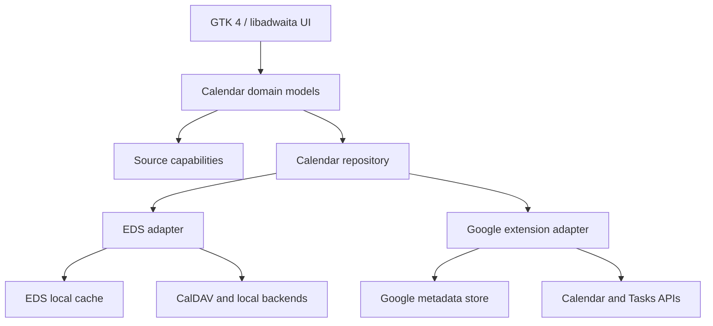

# Architecture

## Direction

Keep GTK 4 and libadwaita as the presentation layer and EDS as the default local
calendar engine. EDS already provides account integration, local caching,
CalDAV, time zones, recurrence expansion, iCalendar objects and offline behavior.
Replacing it would duplicate mature Linux integration and create migration risk.

Add Google-specific behavior behind an adapter only when EDS cannot safely
represent or write a field. The UI talks to provider-neutral models and
capabilities; it does not call Google endpoints directly.

## Ownership and writes

Each calendar has one authoritative writer for an operation. Normal events use
EDS. A Google extension operation reads the current EDS event, applies the
Google-only patch with an ETag precondition, and then lets the normal account
sync refresh EDS. This prevents two independent sync engines from overwriting
the same event.

Provider IDs, ETags, sync tokens, and fields that cannot live in iCalendar are
stored separately from user-visible event data. OAuth refresh tokens belong in
the desktop secret service. Logs must exclude tokens, attendee addresses and
private descriptions by default.

Google incremental synchronization persists `nextSyncToken`, follows pagination,
includes deletions, and performs a new full sync after an HTTP 410 response, as
specified by the [official synchronization guide](https://developers.google.com/workspace/calendar/api/guides/sync).

## Capability model

Capabilities are evaluated per source and, where needed, per event:

- can read and write core iCalendar fields;
- can modify organizer, attendees and participation status;
- can query free/busy and room resources;
- can create conference data and attachments;
- can edit visibility, event color and special event types;
- can manage ACLs, tasks or booking links.

Unsupported data remains visible in a read-only form when that helps the user.
The save pipeline only patches fields changed by the editor.

## Conflict and offline behavior

- EDS remains the offline source for calendars and ordinary events.
- Google-only pending operations use a small durable queue with idempotency data.
- `If-Match`/ETag conflicts pause the write, fetch the server version and present
  a field-level choice when an automatic merge would lose data.
- Deletes are tombstones until both the local and provider operation complete.
- Sync cursors are scoped to account, calendar and query shape.

## Identity

Development builds use `local.nobuhiko.Calendar.Devel`; release builds currently
use `local.nobuhiko.Calendar`. Binary, desktop file, D-Bus service, search
provider, icons and GSettings schemas are isolated from GNOME Calendar. A real
reverse-DNS ID should replace the temporary `local.*` ID before public release.

The gettext domain and internal GResource paths remain compatible with upstream
so existing translations and resources continue to work. These internal names
do not cause desktop registration conflicts.
